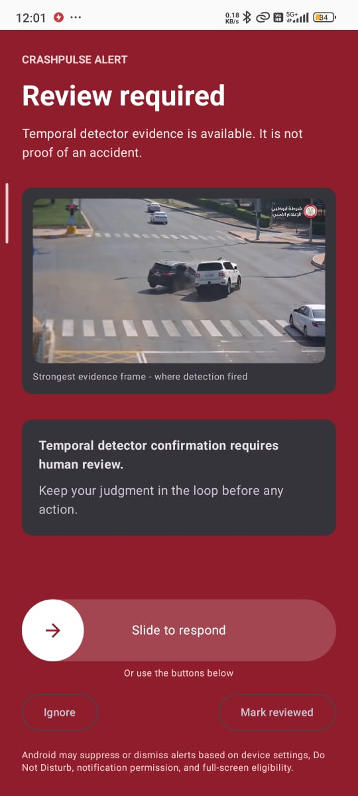
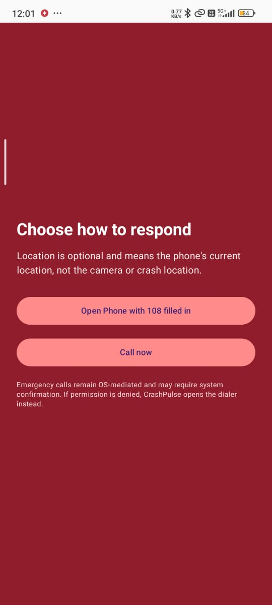
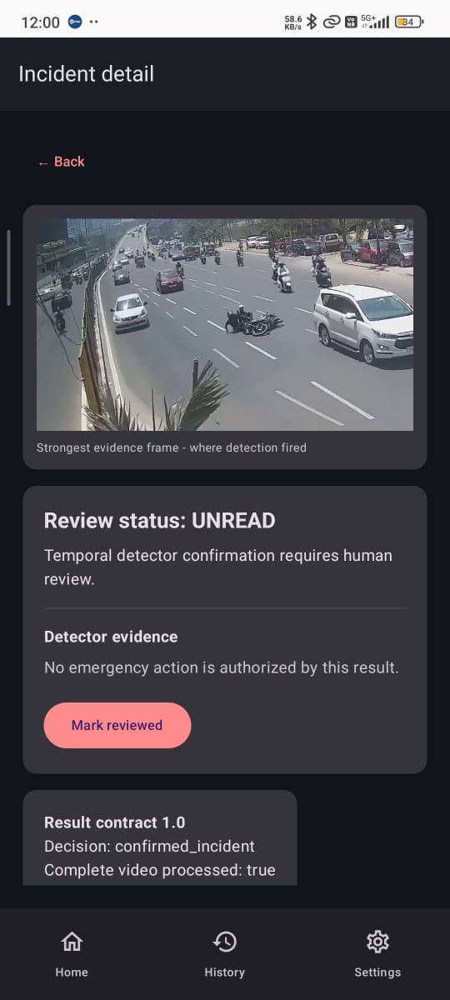
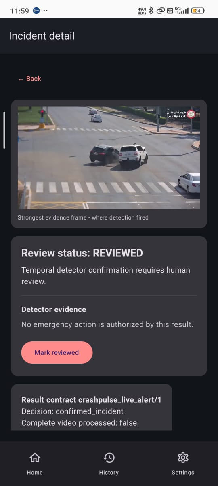
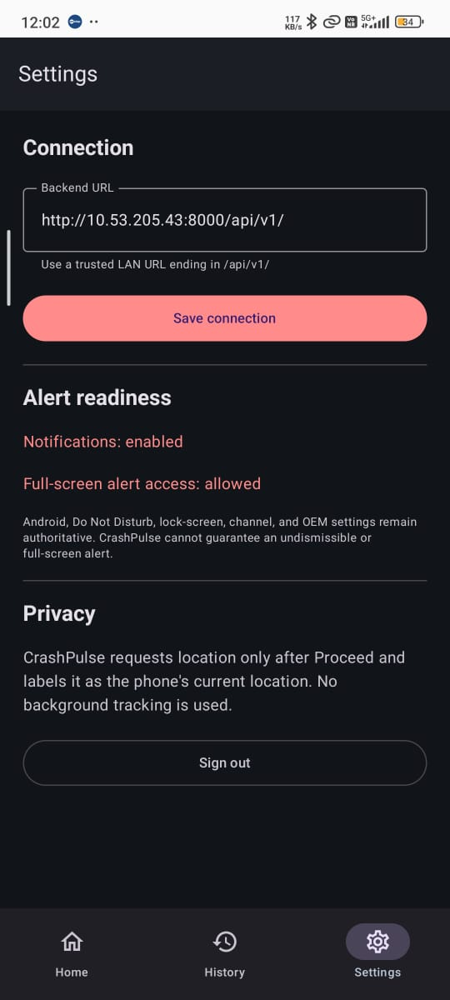

<div align="center">


# CrashPulse

### The Android Client for the CrashPulse Traffic Accident Detection System

**Anand Institute of Higher Technology (AIHT) - An Autonomous Institute**
**Kazhipattur, Chennai**

---

*A native Kotlin / Jetpack Compose application that turns a detector*
*confirmation into an **audible, full-screen, human-reviewed alert** on a*
*handset - and refuses to take any action on a human's behalf.*

[](https://kotlinlang.org/)
[](https://developer.android.com/)
[](https://developer.android.com/jetpack/compose)
[](https://m3.material.io/)
[](https://firebase.google.com/docs/cloud-messaging)
[](https://square.github.io/retrofit/)
[](LICENSE)
[](https://developer.android.com/)

</div>

---

<div align="center">

### Part of a three-component system

| Component | Repository | Role |
|---|---|---|
| **Detector** | [`Accident_Detection`](https://github.com/Rohith-vencenzo/SafeVision-Accident-Detection-Emergency-Response) | YOLO checkpoint + temporal decision engine; decides **whether** an incident occurred |
| **Backend** | [`Accident_Detection/Backend`](https://github.com/Rohith-vencenzo/SafeVision-Accident-Detection-Emergency-Response) | FastAPI + PostgreSQL; records incidents and pushes alerts |
| **Android client** | **this repository** | The human review and response surface |

The **full Accident_Detection project** - detector, backend and this app's
companion runbooks - is at
**https://github.com/Rohith-vencenzo/SafeVision-Accident-Detection-Emergency-Response**

</div>

---

## Table of Contents

1. [Project at a Glance](#1-project-at-a-glance)
2. [Screens](#2-screens)
3. [Repository Layout](#3-repository-layout)
4. [Team, Institute and Supervisor](#4-team-institute-and-supervisor)
5. [Motivation and Problem Statement](#5-motivation-and-problem-statement)
6. [App Architecture](#6-app-architecture)
7. [Technical Background](#7-technical-background)
8. [The Alarm Path](#8-the-alarm-path)
9. [Safety and Privacy Guarantees](#9-safety-and-privacy-guarantees)
10. [Installation and Build](#10-installation-and-build)
11. [Running on a Device](#11-running-on-a-device)
12. [Configuration](#12-configuration)
13. [Backend API Surface](#13-backend-api-surface)
14. [Testing](#14-testing)
15. [Codebase Metrics](#15-codebase-metrics)
16. [Limitations and Future Work](#16-limitations-and-future-work)
17. [Acknowledgements](#17-acknowledgements)
18. [License](#18-license)

---

## 1. Project at a Glance

The detector and the backend decide **whether** something happened. This app is
where a **person** decides what to do about it - and the app is deliberately
built so that a machine never acts first.

CrashPulse is the native Android front end of the CrashPulse system. It receives
a rule-confirmed incident from the local backend over Firebase Cloud Messaging
and turns it into an **audible, full-screen alarm carrying the evidence frame**
that triggered it.

What it does:

- **Signs in** with a backend-provisioned account, storing access and refresh
  tokens in **Android Keystore**-backed encrypted storage.
- **Gates on a versioned Terms & Conditions** document, with an acceptance
  recorded server-side.
- **Raises an alarm-category, ongoing, full-screen notification** with a
  repeating alarm sound and vibration, plus a **slide-to-respond** gesture that
  is deliberately hard to dismiss by accident.
- **Shows the strongest evidence frame** - the actual image on which detection
  fired - so the reviewer judges a picture, not a sentence of text.
- **Loops an alarm-grade tone** while the alert is on screen, and silences it
  the moment the reviewer engages, so it behaves like an incoming call.
- **Records every decision** - Ignore, Mark reviewed, Proceeded - as a
  server-side audit action.
- **Offers two one-tap routes to help** after Proceed: open the dialer with
  **108 pre-filled**, or place the call directly, with a dialer fallback if the
  permission is denied.

> **Safety by design.** CrashPulse **never** auto-calls, never sends SMS, never
> contacts emergency services, and never tracks location in the background. It
> presents evidence and records intent; the **user** performs every outward
> action. A detector confirmation is temporal model evidence requiring human
> review - it is not verified ground truth, and not a medical or emergency
> determination.

---

## 2. Screens

All screenshots below are captured from a **real device** running this app
against the local backend on a trusted LAN.

<div align="center">

| Alarm screen - evidence + slide to respond | Response chooser after Proceed |
|:---:|:---:|
|  |  |

</div>

<div align="center">

| Incident detail - whole-video analysis | Incident detail - live alert |
|:---:|:---:|
|  |  |

</div>

<div align="center">

| Settings - connection and alert readiness |
|:---:|
|  |

</div>

Note the difference visible between the two detail screens: the end-of-run
analysis reports result contract **`1.0`** with `Complete video processed:
true`, while a **live** alert reports contract
**`crashpulse_live_alert/1`** with `Complete video processed: false`. The app
never presents a partial, mid-stream confirmation as though it were a finished
whole-video analysis.

---

## 3. Repository Layout

```text
CrashPulse/
|-- README.md                      <- You are here
|-- LICENSE                        <- Unlicense (public domain)
|-- TESTING.md                     <- Validation matrix and pending device tests
|-- LAN_RUNBOOK.md                 <- Trusted-LAN demonstration procedure
|-- .gitignore                     <- Excludes build output and local secrets
|-- settings.gradle.kts            <- Repositories and module declaration
|-- build.gradle.kts               <- Plugin versions
|-- gradle.properties
|-- gradlew / gradlew.bat / gradle/ <- Gradle 8.13 wrapper
|
|-- app/
|   |-- build.gradle.kts            <- SDK levels, build types, dependencies
|   |-- proguard-rules.pro
|   `-- src/
|       |-- main/
|       |   |-- AndroidManifest.xml
|       |   |-- java/com/collegeproj/crashpulse/
|       |   |   |-- core/
|       |   |   |   |-- di/            Application container (composition root)
|       |   |   |   |-- model/         API DTOs and result views
|       |   |   |   |-- network/       Retrofit service, OkHttp client, repository
|       |   |   |   `-- storage/       Preferences, Keystore-backed session store
|       |   |   |-- feature/
|       |   |   |   |-- alarm/         Alarm activity, review/proceed/call/location
|       |   |   |   |-- auth/          Login, Terms gate, session state machine
|       |   |   |   |-- home/          Clip picker, job submission, polling
|       |   |   |   `-- notifications/  FCM service, channel, alert deduplication
|       |   |   `-- ui/
|       |   |       |-- MainActivity.kt   Compose navigation and screens
|       |   |       `-- theme/             Material 3 colour and theme setup
|       |   `-- res/                     Icons, colours, strings, NSC
|       |-- debug/res/xml/network_security_config.xml  <- Permits LAN cleartext
|       `-- test/java/.../core/model/     Unit tests for API models
|
`-- assets/                        <- Logo and real device screenshots
```

The FastAPI + PostgreSQL backend and the YOLO detector live in the companion
project [`Rohith-vencenzo/SafeVision-Accident-Detection-Emergency-Response`](https://github.com/Rohith-vencenzo/SafeVision-Accident-Detection-Emergency-Response),
which holds the **complete Accident_Detection** system - the detector CLI, the
temporal decision engine, the Backend service, and the runbooks. This repository
contains **only the mobile client**.

---

## 4. Team, Institute and Supervisor

| Field | Value |
|---|---|
| **College** | Anand Institute of Higher Technology (AIHT) - An Autonomous Institute |
| **Location** | Kazhipattur, Chennai |
| **Degree** | B.E. Computer Science & Engineering |
| **Department** | Computer Science & Engineering |
| **Academic Year** | 2023 - 2027 |
| **Supervisor** | Mrs. J. Vinothini, Department of CSE, AIHT |

### Team Members

| # | Name | Roll Number | GitHub |
|---|---|---|---|
| 1 | Rohith Kumar P | 310123104304 | [Rohith Kumar P](https://github.com/Rohith-vencenzo) |
| 2 | Sivaprakash J | 310123104093 | [Sivaprakash J](https://github.com/CoreCoderX) |
| 3 | Kamalnath U | 310123104302 | [Kamalnath U](https://github.com/kamal003-gid) |

---

## 5. Motivation and Problem Statement

Almost every road accident in a city is filmed by somebody. The footage exists.
The **emergency response** to it frequently does not arrive in time, and the
reasons are rarely technical - they are human:

1. **Somebody has to notice.** A collision is a few seconds of a long recording.
   Nobody is watching every feed, all the time.
2. **Somebody has to verify before acting.** False alarms are expensive. A
   reviewer who is handed raw model output with no context will either panic or
   learn to ignore the alerts - both outcomes are worse than no alert at all.
3. **Somebody has to be reachable.** If the alert does not reach a phone, it did
   not happen.

A desktop dashboard solves none of these. The reviewer may be asleep, on a bus,
or in a different building from the screen. What is needed is a **small, loud,
obvious, evidence-carrying alert on the device that is already in their pocket**,
which cannot be actioned by an algorithm.

That last constraint shapes the entire design. An automated system that dials
`108` on a false positive **consumes a scarce emergency resource and trains
people to ignore the product**. CrashPulse therefore treats *decision support*
as the feature and *action* as something only a person may do.

The design question this project answers is therefore not "can a phone detect an
accident" - it cannot - but **"can a phone make a human reliably aware, well
enough informed to judge, and impossible to blame for what they did next?"**

---

## 6. App Architecture

```text
+------------------------- Backend (FastAPI + PostgreSQL) -------------------------+
|  Confirmed incident -> durable outbox row -> Firebase Cloud Messaging (high)     |
+---------------------------------+----------------------------------------------+
                                  |  data-only push { incident_id, title, body }
                                  v
+-------------------------------------------------------------------------------+
|  CrashPulseMessagingService  (FCM, data-only: the OS shows nothing by itself) |
|  - reads incident_id, suppresses duplicates                                    |
+---------------------------------+---------------------------------------------+
                                  |  local notification (immediate, no network)
                                  v
+-------------------------------------------------------------------------------+
|  AlertNotifications                                                     [UI]   |
|  - channel: IMPORTANCE_HIGH, alarm sound, vibration, bypass DND               |
|  - ongoing + no auto-cancel + full-screen intent                             |
+---------------------------------+---------------------------------------------+
                                  |  tap
                                  v
+-------------------------------------------------------------------------------+
|  AlarmActivity   setShowWhenLocked + setTurnScreenOn + KEEP_SCREEN_ON          |
|  - fetches incident + result + strongest evidence frame                       |
|  - loops an alarm-grade tone until the reviewer engages                       |
|  - Slide to respond -> Proceed   |   Ignore / Mark reviewed                 |
+---------------------------------+---------------------------------------------+
                                  v
+-------------------------------------------------------------------------------+
|  CrashPulseRepository (Retrofit/OkHttp, bearer + refresh authenticator)        |
|  POST /incidents/{id}/actions   |   POST /incidents/{id}/location           |
+-------------------------------------------------------------------------------+
```

### Layering

| Layer | Package | Responsibility |
|---|---|---|
| UI | `ui/`, `feature/*` | Compose screens, navigation, alarm activity |
| State | `feature/*/*ViewModel` | Session, home/job and alarm state machines |
| Domain access | `core/network/` | Retrofit service, token refresh, repository |
| Persistence | `core/storage/` | Base-URL preference, Keystore-encrypted session |
| Composition | `core/di/` | Application container wiring the graph |

There is no dependency-injection framework: `AppContainer` constructs the
repository once and hands it to whoever needs it. For an app of this size that is
simpler to follow than a DI graph, and it keeps the alarm path easy to audit -
which matters more here than architectural purity.

---

## 7. Technical Background

### 7.1 Jetpack Compose

Compose builds UI as **state transformed into a description of what to draw**.
When state changes, only the affected recomposition scopes re-run. This is why
the alarm screen can hold a decoded evidence bitmap, a live countdown-free
status, and a set of action buttons without manual view invalidation.

`mutableStateOf` values are hoisted out of composables and passed down, so the
`AlarmActivity` owns the alert state machine (`Loading -> Ready -> Proceeding ->
Proceed`, or `Error`) while the composables stay declarative.

### 7.2 Firebase Cloud Messaging

FCM has two delivery shapes, and the distinction is the crux of this app:

| Shape | Who displays it | Use here |
|---|---|---|
| **Notification message** | The Android system | Not used |
| **Data-only message** | **Your app**, in `onMessageReceived` | **Used** |

The backend sends a **data-only** message deliberately. A notification message
would be displayed by the OS using whatever `title`/`body` the server chose,
with no chance to attach an incident ID, deduplicate, or verify the token is
still valid. With a data-only message, `onMessageReceived` runs, and the app can
decide *whether* to raise an alert and *what* to attach - which is exactly what
the duplicate-suppression and audit guarantees require.

The tradeoff is that a data-only message gives **no delivery when the app is
killed**: the system will not start the process for it. CrashPulse therefore
treats the backend as the durable source of truth and re-syncs on open.

### 7.3 Full-screen intents and alarm-grade alerts

`setFullScreenIntent()` lets an alert **take over the screen** when it arrives,
which is what makes an alarm feel like an alarm. The mechanics are OS-gated:

- `IMPORTANCE_HIGH` + `CATEGORY_ALARM` + `USAGE_ALARM` produce an audible,
  vibrating, high-priority alert.
- On **Android 14+ (API 34+)**, `USE_FULL_SCREEN_INTENT` is **no longer granted
  by default** to arbitrary apps. The app checks `canUseFullScreenIntent()` and
  degrades to a heads-up notification, and Settings offers a deep link to the
  permission screen.
- The notification **channel** is created once and its sound, vibration and
  importance are then **immutable**. That is why this app ships channel
  **`crashpulse_urgent_alerts_v2`**: the earlier channel was created without a
  sound, and simply adding `setSound()` to it would have had no effect on an
  existing install.

### 7.4 Encrypted credential storage

Access and refresh tokens are persisted through
`androidx.security:security-crypto`, backed by a **hardware-backed
`MasterKey` in the Android Keystore**. The raw tokens are never written to
`SharedPreferences` in plaintext, so they cannot be read off a backup or a
compromise of the app's data directory.

### 7.5 Token refresh without a visible login

`OkHttpClient.authenticator` transparently retries a `401` once with a refresh
token, and `ApiClient.service()` rebuilds its Retrofit instance from preferences
on **every call**. The practical consequence is that a **base-URL change takes
effect on the very next request** - no restart, and no stale-host request.

---

## 8. The Alarm Path

```text
 FCM data message
        |
        v
 AlertDeduplicator.accept(incidentId)      -- already shown this one? stop
        |
        v
 AlertNotifications.showIncident(...)
   channel: IMPORTANCE_HIGH | alarm sound | vibration | bypass DND
   ongoing = true, autoCancel = false, full-screen intent
        |
        +--> app open            -> heads-up + alarm screen
        +--> app background      -> heads-up notification
        +--> screen locked       -> visible on lock screen
        +--> screen off          -> full-screen intent (OS permitting)
        |
        v  (tap)
 AlarmActivity
   setShowWhenLocked / setTurnScreenOn / FLAG_KEEP_SCREEN_ON
   loads incident + result + strongest evidence frame
   loops alarm tone until engaged
        |
   +----+----------------------+-------------------+
   |                           |                   |
   v                           v                   v
 Proceed                  Mark reviewed        Ignore
 (slide or button)        status=REVIEWED      status=REVIEWED
   |                           |                   |
   | recordAction(PROCEEDED)   | recordAction      | recordAction(IGNORED)
   v                           |                   |
 stop the alarm tone           v                   v
   |
   +--> capture location ONLY now (explicit consent)
   |
   +--> choose:
        1) ACTION_DIAL  tel:108   -> dialer opens, 108 pre-filled
        2) ACTION_CALL tel:108   -> requires CALL_PHONE, granted at runtime
                                   denied -> falls back to the dialer
```

Two details are deliberate and easy to get wrong:

1. **The alarm tone latches off.** It stops on Proceed, Ignore, or Mark reviewed,
   and a boolean prevents `onResume` from restarting it if the user opens the
   dialer and returns.
2. **Location is captured only after Proceed**, and is labelled
   `phone_current_location_not_crash_location`. It is never collected in the
   background and never attached without an explicit user action.

---

## 9. Safety and Privacy Guarantees

| Guarantee | How it is enforced |
|---|---|
| Never auto-calls | No code path reaches `ACTION_CALL` without a recorded Proceed action |
| Never auto-dials | The dialer only opens after an explicit button press |
| Never dispatches services | No emergency-service integration exists in the app |
| Never sends SMS | No SMS intent is declared or used |
| Never calls in the background | Location is requested only from `AlarmActivity` after Proceed |
| Never promises certainty | UI states the alert is model evidence, not proof |
| Records every decision | Ignore / Mark reviewed / Proceeded are persisted server-side |
| Degrades safely | No session or failed fetch routes to MainActivity with the incident preserved |
| Best-effort alert, honest about it | Settings states Android, DND and OEM settings remain authoritative |

The one outward-facing capability is a **user-initiated** call to `108`. If the
`CALL_PHONE` permission is refused, the app opens the **dialer** instead, so a
user who declines the stronger permission still has a one-tap route to help.

---

## 10. Installation and Build

### 10.1 Prerequisites

| Requirement | Notes |
|---|---|
| **JDK** | Android Studio's bundled **JDK 21** (JDK 17+ works) |
| **Android SDK** | compileSdk **36**, targetSdk **35**, minSdk **26** |
| **Gradle** | Supplied by the wrapper - **8.13**, no local install needed |
| **Device** | Physical Android phone on the **same Wi-Fi** as the backend |
| **Firebase** | `google-services.json` is machine-specific and **not committed** |

### 10.2 Firebase configuration

The Android app is registered as:

```text
Project: crashpulse-clg
Package: com.collegeproj.crashpulse
App ID:   1:944265368587:android:5718da86ab0c029b6aa30e
```

Fetch `google-services.json` on an authenticated machine with the Firebase CLI:

```powershell
firebase apps:sdkconfig ANDROID "1:944265368587:android:5718da86ab0c029b6aa30e" `
  --project crashpulse-clg --out .\app\google-services.json
```

The build **compiles without** that file - the Google Services plugin is applied
conditionally - but Firebase **runtime initialisation** requires it. It is
gitignored and must never be committed or pasted into chat.

### 10.3 Build and test

```powershell
.\gradlew.bat :app:assembleDebug
.\gradlew.bat :app:testDebugUnitTest
```

The debug artifact lands at:

```text
app\build\outputs\apk\debug\app-debug.apk
```

### 10.4 Cleartext HTTP policy

| Build type | Cleartext LAN HTTP | Reason |
|---|---|---|
| **debug** | **Permitted** | Needed for `http://<LAN-IP>:8000` during local demos |
| **release** | **Refused** | `base-config cleartextTrafficPermitted="false"` |

The permissive policy lives **only** in `app/src/debug/res/xml/`, which replaces
the strict `app/src/main/res/xml/network_security_config.xml` for debug builds.
A release build therefore cannot silently fall back to an unencrypted connection.

---

## 11. Running on a Device

### 11.1 Set the backend URL before signing in

Open **Server settings** on the **login screen** - no account is required - or
**Settings** once signed in:

```text
http://<Windows-LAN-IP>:8000/api/v1/
```

> A physical phone must **not** use `10.0.2.2`. That alias resolves only inside
> the Android emulator and points back at the emulator, not your computer. The
> debug default shipped in `build.gradle.kts` is a placeholder LAN address; DHCP
> can change it, which is exactly why the field is editable at runtime.

### 11.2 Install

```powershell
adb install -r app\build\outputs\apk\debug\app-debug.apk
```

### 11.3 First run

1. Open **Server settings**, enter the LAN URL, tap **Save connection**.
2. Sign in with an account provisioned by the administrator - there is **no
   public sign-up** and no password recovery.
3. Accept the current Terms version.
4. Grant the notification permission when prompted.
5. Confirm Settings reports `Notifications: enabled` and
   `Full-screen alert access: allowed`.

Full procedure, including firewall scoping and the required backend bind
address, is in [LAN_RUNBOOK.md](LAN_RUNBOOK.md).

---

## 12. Configuration

| Setting | Where | Default | Purpose |
|---|---|---|---|
| Backend base URL | In-app **Server settings** | `DEFAULT_API_BASE_URL` in `build.gradle.kts` | Trusted LAN endpoint ending in `/api/v1/` |
| Notification permission | In-app **Settings** | - | Required for any alert to display |
| Full-screen access | Android system setting | - | Enables the alarm to take over the screen |
| `CALL_PHONE` | Runtime prompt, on demand | Denied until asked | Enables "Call now"; denial falls back to the dialer |
| Location | Runtime prompt, after Proceed | Denied until asked | Optional; only after an explicit Proceed |

There is no remote configuration file: the app is configured on-device, on the
trusted LAN, by the operator who installed it.

---

## 13. Backend API Surface

The app consumes these endpoints from the companion
[`Accident_Detection`](https://github.com/Rohith-vencenzo/SafeVision-Accident-Detection-Emergency-Response)
project's `Backend/` service. All incident and device routes require a bearer
token and accepted Terms.

| Route | Use |
|---|---|
| `POST /auth/login`, `POST /auth/refresh`, `POST /auth/logout` | Session lifecycle |
| `GET /auth/me` | Current user |
| `GET /terms/current`, `POST /terms/acceptance` | Versioned Terms gate |
| `POST /devices/fcm-token` (+ delete/patch) | Register the push token |
| `POST /videos/analyze`, `GET /jobs/{id}` | Optional clip upload and polling |
| `GET /incidents`, `GET /incidents/{id}` | History list and detail |
| `GET /incidents/{id}/result` | Result contract for the review screen |
| `GET /incidents/{id}/evidence/{name}` | **Strongest evidence frame** |
| `GET /incidents/{id}/report` | Markdown review report |
| `POST /incidents/{id}/actions` | **Ignore / Mark reviewed / Proceeded** audit trail |
| `POST /incidents/{id}/location` | Location, only after Proceed |

---

## 14. Testing

```powershell
.\gradlew.bat :app:testDebugUnitTest
```

Current suite: **2 unit tests** covering the API model layer
(`ApiModelsTest.kt`), all passing. This is deliberately small, and it is the
**honest** number - the project has far more behaviour than automated coverage.

The detailed behaviour matrix, including every scenario still marked *pending
real phone/FCM test*, is maintained in [TESTING.md](TESTING.md). Several
scenarios - background delivery, locked screen, screen off, notification and
full-screen denial, duplicate suppression, location denial - are **implemented
and statically verified but not yet confirmed on a physical device**.

---

## 15. Codebase Metrics

| Package | Kotlin lines |
|---|---:|
| `ui` (Compose navigation and screens) | 342 |
| `feature/alarm` | 286 |
| `core/network` | 140 |
| `feature/notifications` | 111 |
| `feature/auth` | 66 |
| `feature/home` | 41 |
| `core/storage` | 38 |
| `core/di`, `core/model`, `ui/theme` | 47 |
| **Total (main)** | **1,071** |
| Unit tests | 23 |

| Parameter | Value |
|---|---|
| Language / UI | Kotlin 2.2.21, Jetpack Compose (BOM 2025.12.01) |
| Build | AGP 8.13.2, Gradle 8.13, JDK 17 target |
| Network | Retrofit 3.0.0, OkHttp 5.2.1, kotlinx-coroutines 1.10.2 |
| Push | Firebase Messaging 25.0.0 |
| Location | Play Services Location 21.3.0 |
| Storage | androidx.security:security-crypto 1.1.0-alpha07 |
| SDK range | minSdk 26 (Android 8.0) - targetSdk 35 |
| Application ID | `com.collegeproj.crashpulse` |

---

## 16. Limitations and Future Work

### 16.1 Known Limitations

- **The alert cannot be made un-skippable.** No Android app can guarantee this.
  On **Android 14+** full-screen intents are restricted to calling/alarm apps and
  can be disabled by the user; Do Not Disturb, battery optimisation, per-app
  notification permission and OEM background rules can all suppress it. The
  slide-to-respond gesture is the honest ceiling.
- **Push delivery is best effort.** FCM can be delayed or dropped. With the app
  force-killed, a **data-only** message will not be delivered at all - the system
  does not launch the app for it. A notification message would trade away
  deduplication and audit control for background reach.
- **Screen-off wake is not guaranteed** on a device idle long enough to enter
  Doze.
- **No automated behavioural coverage.** 2 unit tests against 1,071 lines. The
  alarm path, dedupe, token refresh and session transitions are untested
  automatically and are validated only by the manual matrix.
- **Location is the phone's, not the crash's.** It is explicitly labelled as
  such and only attached after a Proceed action.
- **A single backend.** There is no failover, no multi-tenant routing, and no
  offline queue for review actions - though the backend incidents themselves
  remain durable, so history survives network loss.
- **Not an emergency system.** CrashPulse informs and records. It does not
  dispatch, and it cannot guarantee that a human is reached in time.

### 16.2 Planned Extensions

1. **Behavioural test coverage** for the alarm state machine, the deduplicator,
   and token refresh, using Turbine and `TestCoroutineRule`.
2. **On-device screenshot instrumentation** via Compose UI tests, to catch
   regressions on the small screens the alert is most likely to break.
3. **Escalation policy** - notify additional reviewers, and a
   no-acknowledgement timeout, so a single sleeping reviewer is not a single
   point of failure.
4. **Incident acknowledgement history** in-app, showing who reviewed what and
   when, without needing the backend admin console.
5. **Crash-type labelling** once the detector grows beyond its single
   `Accident` class, so the reviewer sees what kind of event fired.
6. **Signed release build** with certificate pinning and TLS-only deployment, so
   the debug cleartext exception can be retired entirely.

---

## 17. Acknowledgements

- **Mrs. J. Vinothini**, Department of Computer Science & Engineering, AIHT, for
  guidance and technical feedback throughout this project.
- **Anand Institute of Higher Technology (AIHT)**, Kazhipattur, for the academic
  environment this project was carried out in.
- **[Jetpack Compose](https://developer.android.com/jetpack/compose)** and the
  AndroidX team for the UI toolkit and the Keystore-backed security library.
- **[Firebase](https://firebase.google.com/)** for Cloud Messaging, which is what
  makes a background alert possible at all.
- **[Square](https://square.github.io/)** for Retrofit and OkHttp.
- The maintainers of **[Kotlin](https://kotlinlang.org/)**,
  **[Jetpack Navigation](https://developer.android.com/jetpack/navigation)** and
  **[Turbine](https://github.com/cashapp/turbine)** - without whom this work
  would not have been possible.
- The **CrashPulse backend and detector teams** for the stable incident contract
  this client is written against - see
  [`SafeVision-Accident-Detection-Emergency-Response`](https://github.com/Rohith-vencenzo/SafeVision-Accident-Detection-Emergency-Response).

---

## 18. License

Released into the **public domain** under the
[Unlicense](LICENSE) - free to use, copy, modify, publish, and distribute, with
no restrictions and no warranty.

Note that this covers **this project's source code only**. Third-party
dependencies keep their own licenses - notably Firebase (Apache-2.0),
Retrofit/OkHttp (Apache-2.0) and AndroidX (Apache-2.0).

<div align="center">

---

*CrashPulse - the Android client*
*B.E. Computer Science & Engineering - AIHT, Kazhipattur, Chennai - 2023 - 2027*
*Supervised by Mrs. J. Vinothini, Department of CSE*

[github.com/CoreCoderX/CrashPulse-accident-detection](https://github.com/CoreCoderX/CrashPulse-accident-detection)

Full system (detector + backend): [SafeVision-Accident-Detection-Emergency-Response](https://github.com/Rohith-vencenzo/SafeVision-Accident-Detection-Emergency-Response)

</div>